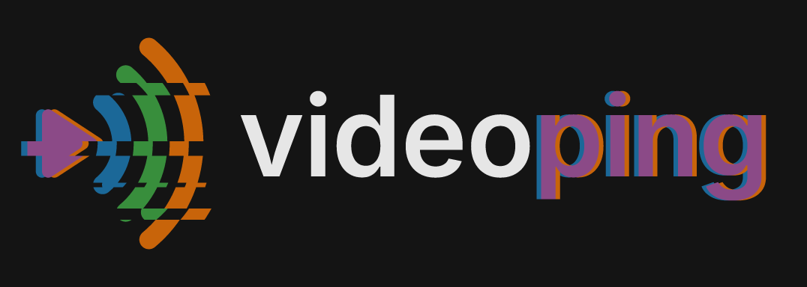
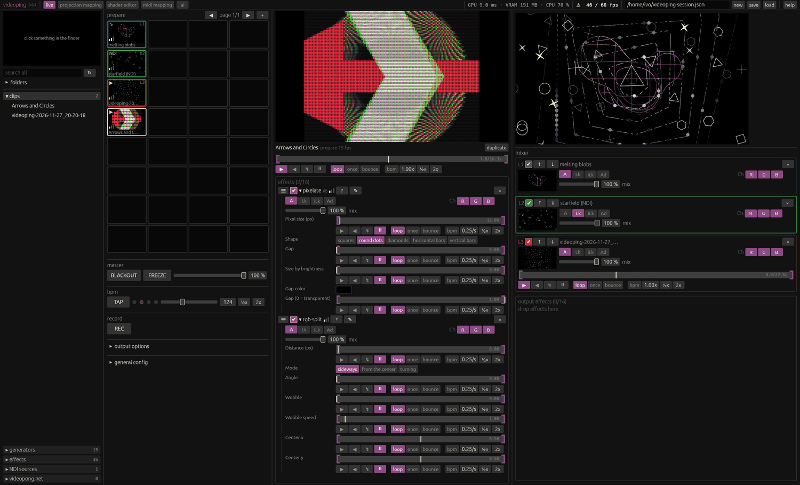
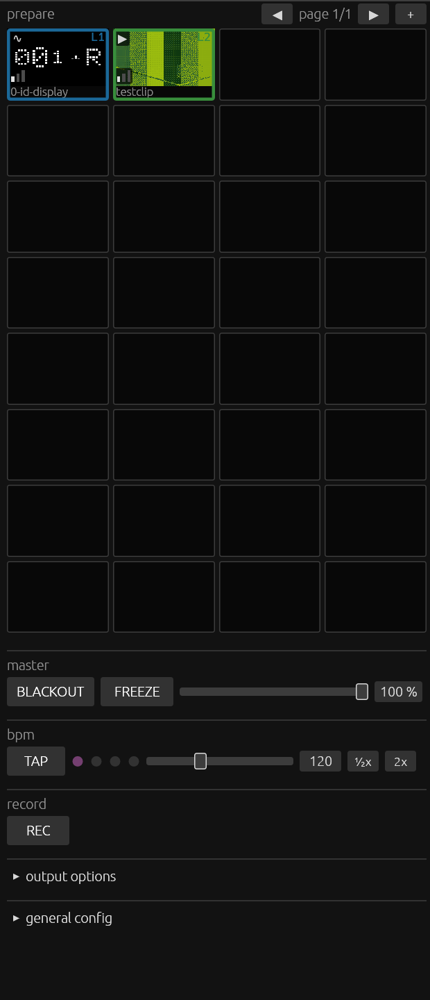
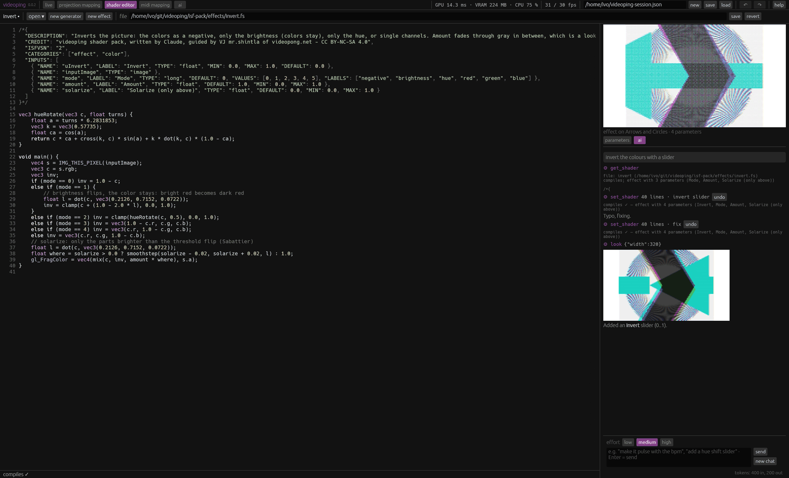
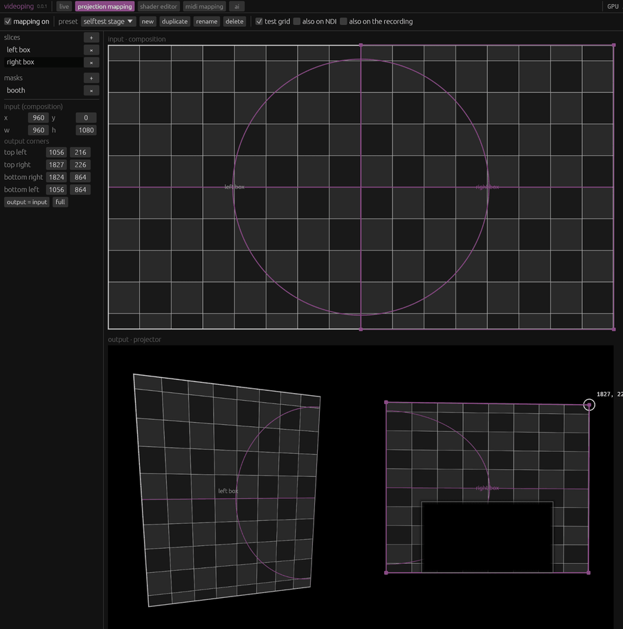
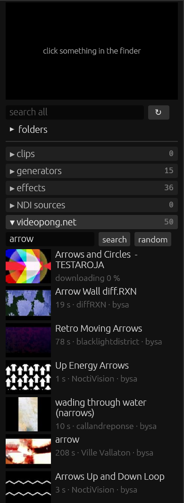

**Live VJ software for Linux, built on ISF shaders, with an AI in the booth.**

Website, manual and install guide: **[videoping.net](https://videoping.net)**

> **Early alpha.** videoping is completely vibecoded with Claude (Claude Code): about
> 14,000 lines of Rust, none of them typed by hand. Expect rough edges, few tested
> machines and formats that may still change.



## why

I love Resolume and VDMX and played hundreds of gigs with them. But I love Linux too, and
waited a decade for a Linux release of either. It never came. Now, with AI, I can build the tool
I always wanted myself: videoping.

Most VJ setups are a stack of separate tools: a player, a mapper, a shader editor, a browser
full of footage tabs, a MIDI bridge. videoping is one program, built for playing live.

## features

- **made for your hands**: any MIDI controller (pads, faders, knobs, endless encoders): press
  learn, touch a control, done; LEDs and rings show the real state, knobs can follow the effect
  you open, one profile per device; example profiles for a pad grid and an encoder box built in
- **every effect is an ISF shader**: generators and effects are plain [ISF](https://isf.video)
  files (GLSL with a JSON header); videoping builds the controls from the header, reloads on save
  and shows an optional `.md` doc next to each shader
- **shader pack**: 16 generators in `isf-pack/generators/` (contour map, synthwave, CRT TV,
  dot matrix, melting blobs, endless corridor, halftone sphere ...), the 3D ones switchable to
  wireframe, outline, dots or x-ray
- **plays** mp4 clips (GStreamer, hardware decoding), ISF generators, NDI sources and
  [videopong.net](https://www.videopong.net) clips
- **prepare, then go live**: tune every clip, generator and effect in a prepare lane before it
  reaches the output; the live mix always gets the GPU first
- **shader editor** with live preview, error lines mapped back to the file, and an AI that writes
  and fixes shaders
- **ai tab**: tell it "fade layer 2 out slowly"; it acts, looks at the output and lists every change
  with undo (Anthropic or any OpenAI-compatible API, your own key); also an MCP server
- **projection mapping**: slices with perspective-correct corner pin, soft masks, a test grid and
  presets per venue
- **videopong.net built in**: search 27,000+ Creative Commons clips from the finder, preview, drag
  onto a slot; downloads stay on your disk (for now the public 480×360 preview mp4, not the
  original file)
- **output**: fullscreen on any screen, NDI out, hardware-encoded recording (NVENC / VA-API)
- no audio, by design

| | |
|---|---|
|  |  |
|  |  |

## install

There are no binary packages yet; you build it from source once.

```sh
git clone https://github.com/toastbrotch/videoping.git && cd videoping
cargo build --release
./target/release/videoping
```

Requirements (OpenGL 3.3, GStreamer 1.20+, optional NDI 6 runtime), the launcher entry and
running on NVIDIA in hybrid laptops: see [install.md](install.md) (also on the web:
[videoping.net/install.html](https://videoping.net/install.html)).

## documentation

- [videoping.net](https://videoping.net): the website
- [videoping.net/manual.html](https://videoping.net/manual.html): the end-user manual (source: `website/manual.html`)
- [install.md](install.md): installation
- [dev.md](dev.md): building, modules, self-tests
- [features.md](features.md): the spec, with every design decision

## community

From the maker of [videopong.net](https://www.videopong.net), the non-profit share-and-remix
platform for VJs, and [linux4vjs.net](https://linux4vjs.net).

## license

- the program: [GPL 3.0 or later](LICENSE)
- the shaders that come with videoping: [CC BY-NC-SA 4.0](LICENSE-shaders.md)
- the name "videoping" and the logo are not covered by either license
