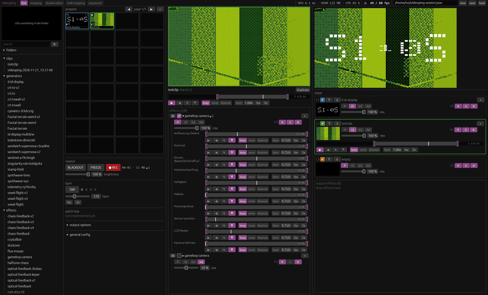
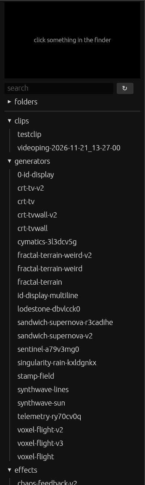
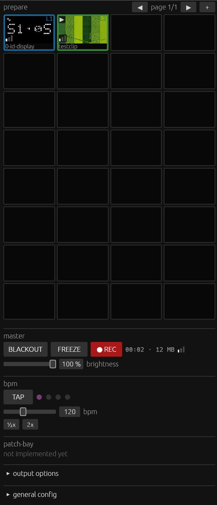
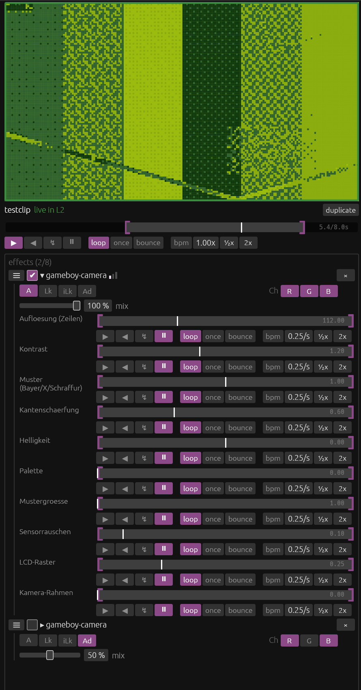
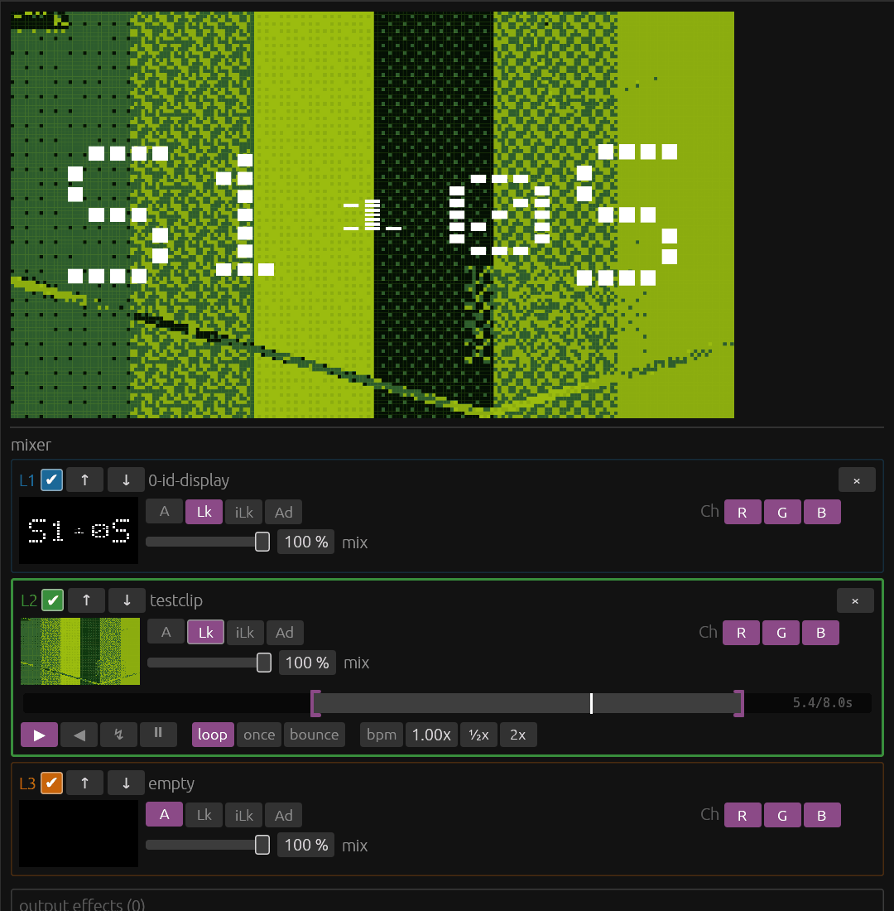

videoping manual
================

videoping is a live VJ tool for Linux: clips, ISF generators and NDI sources are prepared in a grid,
get effects, and are mixed live on 3 layers into one output, which goes to a screen, to NDI and to a
recording. This manual explains how to play with it. Installation is in [install.md](install.md).



Contents

1. [Concept](#1-concept)
2. [The screen](#2-the-screen)
3. [Playing a set](#3-playing-a-set)
4. [Clips and parameters](#4-clips-and-parameters)
5. [Effects](#5-effects)
6. [Output: screen, NDI, recording](#6-output-screen-ndi-recording)
7. [Performance](#7-performance)
8. [Files and settings](#8-files-and-settings)
9. [Troubleshooting](#9-troubleshooting)

---

# 1. Concept

**Sources.** Three kinds of material can be played:

| badge | source | what it is |
|---|---|---|
| ▶ | clip | a video file (mp4, mov, mkv, webm, …) with a timeline |
| ∿ | generator | an ISF shader that makes images by itself |
| NDI | NDI source | a live video stream from the network (another computer, a camera, another program) |

**Instances.** Everything you put into the prepare grid becomes an *instance*: a source plus its own
settings (in / out points, speed, effects, parameters). The same file can be in the grid several
times with different settings; *duplicate* makes such a copy, and a duplicated generator looks
different, because every instance has its own random seed.

**Prepare and live.** The prepare grid is your crate of material. To play an instance, load it into
one of the **3 mixer layers**. It is then *live* — and it is still the **same instance** as in the
grid, not a copy: whatever you change in the prepare detail (effects, speed, limiters) changes the
output immediately. A live slot has a border in the color of its layer.

**Colors mean layers.** Blue = layer 1, green = layer 2, orange = layer 3. These three colors are
used for nothing else, so you can always see what plays where (on screen and later on the Bhoreal).
Everything else is grey, plus one plum accent color for "on" (selected buttons, effect switches,
range sliders).

**Effects** are ISF effect shaders. They sit either on an instance (they travel with it into any
layer) or on the whole output (output effects, after the mixer). An effect can be moved between the
two with all its settings.

**Signal flow**

```
instance:  source -> effect 1 -> effect 2 -> ...      (up to 8 effects)
mixer:     layer 3 (bottom) -> layer 2 -> layer 1 (top), each with mix-type, mix %, R G B
output:    mixer -> output effects -> freeze -> brightness / blackout -> screen, NDI, REC
```

---

# 2. The screen

Four areas from left to right; all column borders can be dragged.

## Top bar


- **live** is the only tab so far (mapping, shader editor, midi mapping and sequencer come later).
- A status message appears for a few seconds (saved, loaded, recording to …).
- **GPU · VRAM · CPU**: what videoping uses right now (see [Performance](#7-performance)).
- **fps counter** `measured / target fps`: grey = fine; white with ⚠ = the output does not reach its
  frame rate.
- The **session file** path and **new / save / load** (see [Files and settings](#8-files-and-settings)).

## Column 1: finder



- **finder preview** on top: click a file to see it there before using it.
- **search** filters the list; **↻** rescans the folders (normally not needed: new files appear by
  themselves within 2 s).
- **folders**: the folders the finder shows; add one with its path, remove one with ×.
- The list is grouped into **clips**, **generators**, **effects** and **NDI sources** (found
  automatically on the network). Whether a shader is a generator or an effect is read from the shader
  itself, not from the folder it is in.
- Click = preview, double-click = add to the first free prepare slot (an effect: add it to the
  selected instance), drag = drop onto a slot (a new instance, or replaces one that is not live) or,
  for effects, onto a slot or an effect stack.

## Column 2: prepare grid, master, bpm, settings



- **prepare grid**: 4 × 8 slots (the size of the Bhoreal's columns 2–5). More than 32 instances: **+**
  adds a page, **◀ ▶** switch pages.
  - badge top left: ▶ clip, ∿ generator, NDI; top right the layer it is live in (L1–L3)
  - border: layer color = live, white = selected, grey = idle
  - small grey bars bottom left: resource meter (see [Performance](#7-performance))
  - × bottom right (on hover) deletes the instance — not while it is live
- **master**: BLACKOUT, FREEZE, REC and the brightness slider.
- **bpm**: TAP, the beat dots, the bpm slider, ½x / 2x.
- **patch-bay**: not implemented yet.
- **output options** (fold open): resolution, frame rate, screen, output window, NDI, GPU.
- **general config** (fold open): resource meters, recording folder.

## Column 3: prepare detail



The selected instance: its **preview** on top (stays visible when you scroll), its name, where it is
live ("live in L2") or — when it is not live — at which rate its preview runs ("prepare 30 fps",
see [Performance](#7-performance)), **duplicate**, then the **clip controls** (clips only) and the
**effect stack**.

## Column 4: mixer and output



- **main output preview** on top (stays visible). The two previews always have the same size.
- **mixer**: 3 layers, layer 1 on top. Each layer: on / off checkbox, ↑ ↓ to change the order,
  × to unload, mix-type, R G B, mix %, and for clips a compact timeline with the transport.
  The selected layer is marked; click a layer to select it.
- **output effects** below: effects on the whole mix.

---

# 3. Playing a set

**Collect material.** Add your folders under *folders* in the finder. Drag clips, generators and NDI
sources into the prepare grid, or double-click them. Arrange slots by dragging them.

**Prepare.** Click a slot: its detail opens in column 3. Set in / out points, speed, add effects —
all before anything is live. The preview shows the result.

**Go live.**
- Select a mixer layer (click it), then **double-click** a slot: it plays in that layer.
- Or drag a slot onto a layer.
- Click a live layer: its instance is selected in the grid (the page switches if needed), so you can
  tweak it right away.

**Mix.** Per layer (and per effect, it works the same):

| button | mix-type |
|---|---|
| A | alpha: plain crossfade with the mix slider |
| Lk | luma key: dark parts of the layer become transparent |
| iLk | inverted luma key: bright parts become transparent |
| Ad | add: the layer is added on top (brightens) |

- **mix %**: 100 % = fully on, 0 % = off.
- **Ch R G B**: which color channels of the layer are mixed in. Switch one off and that channel comes
  only from the layers below — a quick way to color effects.
- The checkbox switches a whole layer off and on, ↑ ↓ change the order, × unloads it.

**Master** acts on the very end of the chain, for screen, NDI and recording alike:
- **BLACKOUT**: output black at once. During a blackout the brightness slider shows 0 %: pull it up
  to **fade in** from black (that ends the blackout). Pressing BLACKOUT again jumps back to the
  previous brightness.
- **FREEZE**: holds the current output frame while you change things underneath.
- **brightness**: overall level of the output.
- Panic = BLACKOUT, or FREEZE when the picture should stay.

**Tempo.** Tap **TAP** on the beat a few times; the dots show the beat. The slider sets the bpm by
hand (whole bpm only), ½x / 2x halve and double it. The bpm drives clips and parameters in bpm mode
and all jumpcuts.

---

# 4. Clips and parameters

## Clip transport

Clips (not generators or NDI sources) have a timeline:

- Drag the **[** and **]** handles to set the in and out point (the part that plays). Click or drag
  elsewhere on the bar to jump.
- Play mode: **▶** forward, **◀** backward, **↯** jumpcut (jumps to a random position between the
  handles every N beats), **⏸** pause.
- **loop / once / bounce**: once stops at the end; switching to loop then starts it again, switching
  to bounce plays it back.
- Speed, two modes:
  - free: a speed factor (1.00x = normal; drag the number)
  - **bpm**: how many beats the part between the handles lasts (e.g. 8 beats at 120 bpm = 4 s,
    whatever the length of the clip). In bpm mode the same number also sets the jumpcut interval.
- **½x / 2x**: half / double speed at once.

The layer in the mixer shows the same transport in compact form — it is the same instance, so both
change the same settings.

## Parameters

Every effect and generator parameter has the same kind of control:

- **range slider**: the white line is the value. In pause mode, click or drag on the bar to set it.
  The **[ ]** handles set a range for the animation.
- The row below **animates** the value inside that range, with the same buttons as a clip: forward,
  backward, jumpcut, pause; loop / once / bounce; free speed (per second) or bpm (beats per cycle);
  ½x / 2x.
- On / off parameters are checkboxes, colors a color button, lists a dropdown.
- **Right click** on a parameter (its name or its control) resets it to the shader's default: value,
  full range, animation off.
- Long names wrap; hover over a name to see it in full.

---

# 5. Effects

- **Add**: drag an effect from the finder onto a slot, onto the effect stack of the selected
  instance, or onto the output effects. Double-click adds it to the selected instance.
- Up to **8 effects** per instance; output effects have no limit.
- Each effect row: **≡** drag handle, on / off checkbox, **▸ / ▾** to show / hide the parameters,
  the name, ×. Mix-type, R G B and mix % always stay visible, also when folded.
- **Order**: drag the ≡ handle up or down. The first effect is applied first.
- **Move** an effect between an instance and the output effects: drag its ≡ handle onto the other
  stack. It keeps all its settings.
- A shader that does not compile shows a red ⚠ next to its name; hover for the error.

---

# 6. Output: screen, NDI, recording

Settings are in **output options** (column 2).

- **resolution** and **frame rate** (25 / 30 / 50 / 60) of the output. Screen, NDI and recording all
  use them.
- **output window**: opens the output in its own window. Double-click it or press **F** for
  fullscreen on the chosen **screen**, **Esc** to leave fullscreen. "connected" lists the screens
  the system sees.
- **NDI output**: sends the output to the network under the **ndi name**. Needs the NDI runtime
  (see install.md); if videoping cannot find it, set the **NDI library folder**.
- **NDI input**: NDI sources on the network show up in the finder; use them like clips.
- **GPU**: shows the graphics card in use; on hybrid laptops "render on NVIDIA GPU" restarts
  videoping on the NVIDIA card.

## Recording (REC)

- **REC** (in master) records the output — after master, exactly what NDI sends — as an H.264 mp4 in
  the **recording folder** (general config; default `~/Videos/videoping`), named with date and time.
- While recording: **● REC**, running time, file size and a resource meter.
- The file plays again in videoping with all transport modes (also backward and jumpcut). Add the
  recording folder to the finder ("add to finder" in the general config) and drag a recording onto a
  slot.
- Recording continues through *new* and *load*; it stops when you change the output resolution, and
  is finished properly when you quit. If videoping crashes, the file still plays up to about 2 s
  before the crash.
- It needs a hardware video encoder (NVIDIA, or Intel / AMD via VA-API). Without one REC is greyed
  out; hover it to see why.
- About 300 MB per minute at 1080p60.

---

# 7. Performance

videoping tells you when it gets too heavy, before the audience sees it.

**fps counter** (top bar): `measured / target fps`. Grey = fine. White with ⚠ = the output is below
its frame rate or dropped a frame in the last 2 seconds; hover for the number of dropped frames.

**Resource meters**: three small grey bars — 1 = light, 2 = medium, 3 = heavy.

- on a prepare slot (bottom left): the whole instance, source plus its effects
- next to an effect name: that effect alone
- next to REC: the recording
- only shown while something is actually rendered (live, selected or previewed)
- hover for the numbers: GPU time and its share of one frame, video memory, and for clips the
  decoder (hardware / software) and whether it keeps up
- the top bar shows the totals: GPU time per frame, video memory, CPU; hover for RAM
- "heavy" means: this item alone takes 40 % or more of a frame at your frame rate, uses a lot of
  video memory, or (clips) the decoder does not keep up
- switch the meters off in the general config if you do not want to see them

**The main mix has priority.** The live layers and the output are always rendered first. Things that
are only in prepare — the selected instance when it is not live, the finder preview, thumbnails —
come after that, at a lower rate:

- normally half the output rate ("prepare 30 fps" in the detail header)
- slower when the main mix gets busy (15, 7.5 fps)
- "paused: main mix has priority" when the main mix needs the whole frame

So a heavy shader you are only looking at in prepare does not slow down the output. Animations keep
their real speed at the lower rate; nothing jumps when the instance goes live.

**When it gets tight**

- Look for the instance or effect with 3 bars and switch it off or replace it.
- Lower the output **resolution** or **frame rate**.
- A clip decoding in software (hover the meter) at high resolution costs a lot of CPU; convert it to
  H.264 so the graphics card can decode it.
- On a laptop with two graphics cards, try the NVIDIA card (output options → GPU).
- On Wayland the desktop itself can limit the frame rate (see [Troubleshooting](#9-troubleshooting)).

---

# 8. Files and settings

**Session**: everything you set up — prepare grid (all pages, instances, effects, parameters), mixer
layers, output effects, bpm, master, output options, finder folders.

- **Autosave**: the session is saved every 2 s when something changed, and on quit. After a restart
  or a crash everything is back.
- **save / load** write / read the session file named in the text field (default
  `~/videoping-session.json`). Media are referenced by path, never copied: keep your files where they
  are, or the instances show an error.
- **new** clears everything after asking: grid, mixer, effects, bpm, master. Finder folders and output
  options stay (that is your setup, not your set).

**General config** (column 2): settings of the program itself, not part of a session — save, load and
new do not touch it. Resource meters on / off, recording folder.

**Where files go**

| what | where |
|---|---|
| autosave | `~/.local/share/videoping/autosave.json` |
| general config | `~/.config/videoping/config.json` |
| window and column layout | `~/.local/share/videoping/` |
| sessions (save / load) | the path in the top bar, default `~/videoping-session.json` |
| recordings | recording folder, default `~/Videos/videoping/` |

**Shaders** are ISF files (`.fs`). videoping uses them as they are and reloads a shader when its file
changes, so you can edit a shader in a text editor while it plays.

---

# 9. Troubleshooting

**The fps counter shows ⚠ although nothing is heavy.** On Wayland the desktop limits how often
videoping may draw; on some laptops that is below 60 fps (e.g. ~53 fps on Intel, 30 fps with the
NVIDIA card). Set the output frame rate to 50 or 30, or see the NVIDIA / X11 notes in install.md.

**NDI does not work** ("libndi not found"). Install the NDI runtime (install.md, section 2), or set
the folder with `libndi.so.6` in output options → NDI library folder.

**Wrong graphics card.** The top bar status and output options → GPU show which card renders. On a
hybrid laptop tick "render on NVIDIA GPU" (applies after a restart) or start with
`videoping --nvidia`.

**A shader shows a red ⚠.** It does not compile; hover the ⚠ for the error message. Fix the file —
videoping reloads it by itself.

**A clip shows "error".** The file is missing (moved or renamed) or cannot be decoded; hover the slot
for the message.

**REC is greyed out.** No working hardware encoder was found; hover REC for the reason. NVIDIA needs
the NVIDIA driver, Intel / AMD the VA-API GStreamer plugins (install.md, section 1).

**A recording does not appear in the finder.** Add the recording folder to the finder: general config
→ "add to finder".

**Some symbols show as boxes.** Install the DejaVu fonts (`fonts-dejavu-core`).
